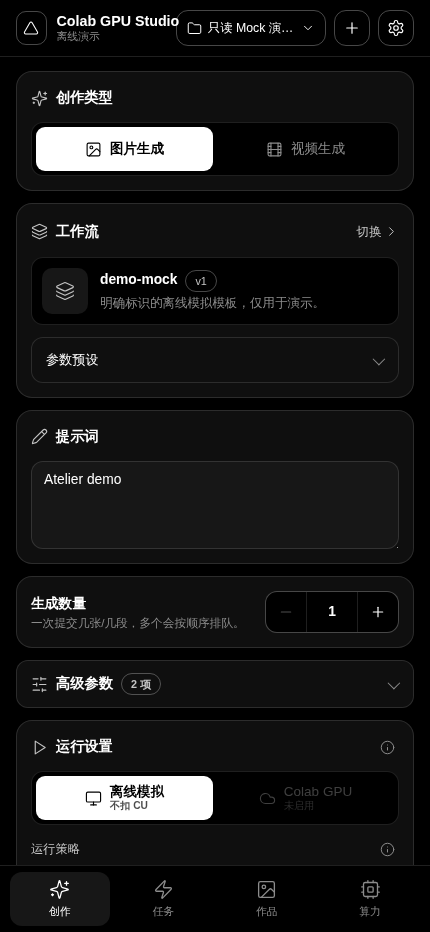
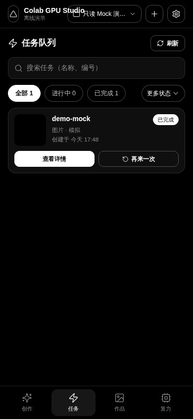
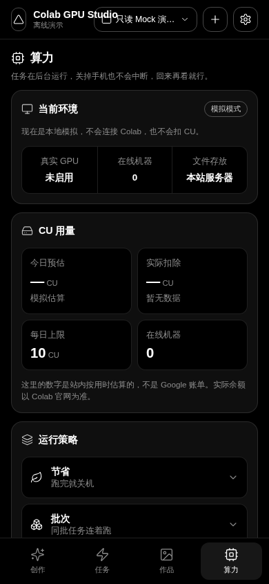
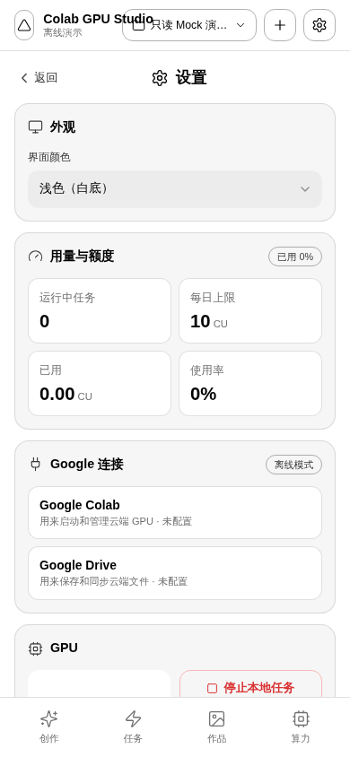
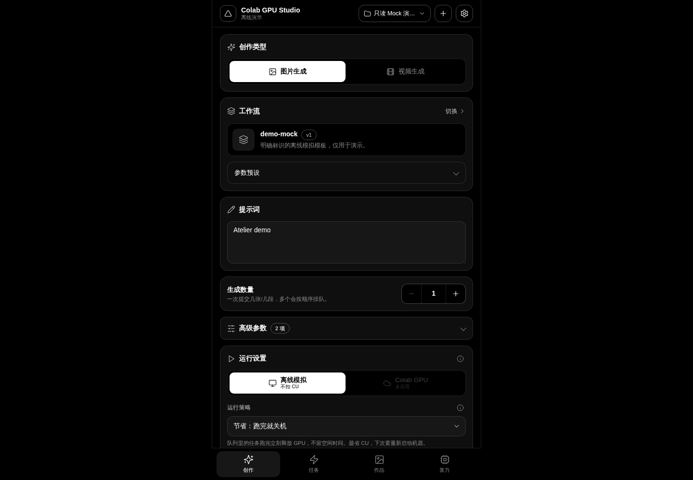

# 在线界面演示

## 打开演示

- 地址：https://gpu-colab-studio-demo.tizenry.tech
- 公开演示密码：`demo-readonly`（不是生产密码）
- 程序版本：**0.1.31-dev.8**
- 构建来源：`f706918b30245ed70a6054ef7eb5a658eb0fb6b8`。相对 Release tag `v0.1.31-dev.8` 的应用代码没有变化，main 只多文档。
- 部署方式：Cloudflare Worker + Static Assets；不依赖常驻演示服务器。

## 演示能做什么

浏览创作、任务、作品、算力、设置及工作流列表，调整本地表单和深浅主题。原前端源码、样式、构建配置没有修改。

这里是**只读 Mock 快照**，不是生产后台：数据来自原项目在本机隔离模式下运行后的真实 API 响应。示例任务和示例图由原版 Mock 执行器产生，不是 AI 模型出图；页面中的模拟时长和用量不代表真实 GPU 性能或账单。

只有公开演示登录可用。任务提交、重试、上传、删除、修改、Google 授权等写请求都会被部署侧只读适配层拒绝。输入的创作参数不会提交到生产系统，也不会调用 Colab 或消耗 CU。不要在公开演示中输入私密提示词、上传资料或粘贴任何密钥。

需要实际生成，请到 [Release](https://github.com/TizenryA/colab-gpu-studio/releases/tag/v0.1.31-dev.8) 下载完整版，使用自己的配置和账号。现有生产站未因本次演示部署而改动。

## 本次验证范围

- 前端从锁定提交执行 `npm ci`、`npm run build`，构建成功。
- 线上 HTML、JS、CSS 与本次原版构建产物逐字节 SHA-256 一致。
- Chromium 实际完成登录、五页浏览、主题切换、刷新后保持登录态；无页面异常、失败网络请求或初始 API 错误。
- 检查 390 宽手机视口及 1440 宽桌面视口，无横向溢出；另附 430 宽截图。390 窄屏顶栏存在文字挤压，遵照“不改应用代码”原样保留。
- 示例缩略图加载成功；写请求实测返回 HTTP 403。
- 本次没有访问生产业务数据、授权 Google 或启动真实 GPU；不属于真实模型、warm reuse 或 CU 节约验收。
- 这些是响应式 Chromium 截图，不是实体 Android、Windows 或 macOS 的运行证明。各安装包的平台验证边界以 Release 说明为准。

## 线上实拍

| 创作（430 宽） | 任务（390 宽） |
|---|---|
|  |  |

| 算力（390 宽） | 设置 · 浅色（390 宽） |
|---|---|
|  |  |

### 桌面

